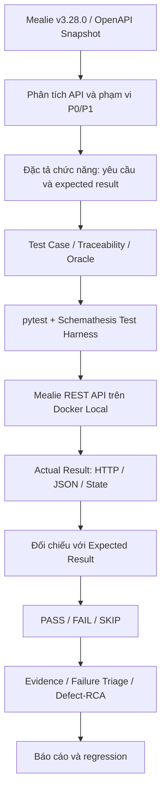

# R02-K05-Mealie-QA

> Đồ án môn **Kiểm thử phần mềm** – kiểm thử REST API của Mealie bằng phương pháp **Schema-Based API Testing / Fuzz Testing** với Schemathesis.

---

## Mục lục

- [1. Giới thiệu](#1-giới-thiệu)
- [2. Mục tiêu](#2-mục-tiêu)
- [3. System Under Test](#3-system-under-test)
- [4. Công nghệ và công cụ](#4-công-nghệ-và-công-cụ)
- [5. Thành viên và phân công](#5-thành-viên-và-phân-công)
- [6. Kiến trúc kiểm thử](#6-kiến-trúc-kiểm-thử)
- [7. Cấu trúc repository](#7-cấu-trúc-repository)
- [8. Trạng thái dự án](#8-trạng-thái-dự-án)
- [9. Phạm vi kiểm thử](#9-phạm-vi-kiểm-thử)
- [10. Chiến lược kiểm thử](#10-chiến-lược-kiểm-thử)
- [11. Business Flows](#11-business-flows)
- [12. Cài đặt và chạy Mealie](#12-cài-đặt-và-chạy-mealie)
- [13. API Documentation](#13-api-documentation)
- [14. OpenAPI Snapshot](#14-openapi-snapshot)
- [15. Schemathesis](#15-schemathesis)
- [16. Git Workflow](#16-git-workflow)
- [17. Security & Safety](#17-security--safety)
- [18. Tài liệu dự án](#18-tài-liệu-dự-án)
- [19. Tiến độ tiếp theo](#19-tiến-độ-tiếp-theo)
- [20. Ghi chú](#20-ghi-chú)

---

## 1. Giới thiệu

**R02-K05-Mealie-QA** là đồ án môn **Kiểm thử phần mềm**, kết hợp:

- **R02 – Mealie:** hệ thống quản lý công thức nấu ăn và meal planning được sử dụng làm System Under Test (SUT).
- **K05 – Schema-Based API / Fuzz Testing:** kỹ thuật kiểm thử API dựa trên API schema.
- **Schemathesis:** công cụ chính được sử dụng để sinh và thực thi các test case dựa trên OpenAPI schema.

Dự án tập trung vào việc xây dựng một quy trình kiểm thử REST API có kiểm soát và có khả năng tái lập:

```text
Mealie
   ↓
OpenAPI Schema + Phân tích nghiệp vụ
   ↓
Functional Specification (REQ / Expected)
   ↓
Test Cases & Traceability Matrix (TC / Oracle)
   ↓
pytest + Schemathesis
   ↓
Generated / Directed Test Inputs
   ↓
Mealie REST API
   ↓
Test Results
   ↓
Failure Triage / Evidence / Defect Analysis
```

Toàn bộ hoạt động fuzz testing được giới hạn trong môi trường **local/lab**, không thực hiện trên hệ thống production hoặc public server.

---

## 2. Mục tiêu

Các mục tiêu chính của dự án:

1. Xây dựng môi trường Mealie local có khả năng tái lập.
2. Pin chính xác phiên bản SUT để toàn bộ thành viên sử dụng cùng một baseline.
3. Thu thập và lưu OpenAPI schema làm schema baseline.
4. Phân tích cấu trúc REST API của Mealie.
5. Xác định phạm vi API phù hợp với schema-based testing.
6. Xây dựng đặc tả chức năng, scenarios, invariants và test oracles có căn cứ từ OpenAPI.
7. Thiết kế test case và ma trận truy vết REQ → TC → expected → actual → defect.
8. Sử dụng Schemathesis/pytest để sinh và chạy test trên phạm vi được kiểm soát.
9. Thu thập evidence, so sánh kết quả với đặc tả và phân tích các failure.
10. Phân biệt API defect, schema issue, environment issue và false positive.
11. Đảm bảo quy trình kiểm thử có thể được tái lập trên môi trường khác.
12. Tổng hợp kết quả phục vụ báo cáo và trình bày môn học.

---

## 3. System Under Test

System Under Test của dự án là **Mealie**.

| Thuộc tính | Giá trị |
|---|---|
| SUT | Mealie |
| Release | `v3.28.0` |
| Pinned commit | `0552eaa4a80031b8572849cca0ed95d07f1be001` |
| API style | REST |
| API specification | OpenAPI |
| OpenAPI version | `3.1.0` |
| OpenAPI paths | `182` |
| API operations | `266` |
| Local host port | `9091` |
| Container port | `9000` |

Phân bố các HTTP operations trong schema baseline:

| HTTP Method | Operations |
|---|---:|
| GET | 115 |
| POST | 82 |
| PUT | 36 |
| PATCH | 3 |
| DELETE | 30 |
| **Tổng** | **266** |

Phiên bản SUT được xác định bằng **Git tag + commit SHA**, không dựa duy nhất vào version string do runtime trả về.

---

## 4. Công nghệ và công cụ

| Công nghệ / Công cụ | Mục đích |
|---|---|
| Mealie | System Under Test |
| REST API | Đối tượng kiểm thử |
| OpenAPI 3.1 | API schema |
| Schemathesis | Schema-Based API / Fuzz Testing |
| Python 3.11 | Test environment |
| Docker | Chạy Mealie local |
| Docker Compose | Quản lý container |
| Git | Version control |
| GitHub | Repository, branch và Pull Request |

### Test environment hiện tại

```text
Python:       3.11.9
Schemathesis: 4.28.0
```

Schemathesis được pin trong:

```text
tests/requirements.txt
```

> Bộ kiểm thử pytest/Schemathesis hiện có evidence thực thi P0/P1; trạng thái PASS/FAIL của lần chạy đã lưu được tổng hợp tại mục 8. Việc cài đặt công cụ riêng lẻ không đồng nghĩa với chất lượng API đạt yêu cầu.

---

## 5. Thành viên và phân công

> **Phân công cập nhật phục vụ giai đoạn tích hợp, đặc tả và hoàn thiện báo cáo.** Bảng xác định người chịu trách nhiệm chính; các thành viên khác phối hợp và phản biện. Vai trò mới cần được nhóm thống nhất, đồng bộ với phụ lục phân công trong báo cáo Word. Công việc chỉ được đánh dấu hoàn thành khi có tài liệu, mã nguồn hoặc evidence tương ứng.

| Thành viên | MSSV | Vai trò chính |
|---|---|---|
| Nguyễn Minh Long | 2314361 | Leader & Defect Analysis Owner |
| Lương Hữu Thiện | 2312753 | System Integration, Specification & Test Design Owner |
| Hoàng Bình Quân | 2314236 | System Analysis & Quality Review Owner |
| Nguyễn Hồng Phúc Thọ | 2312758 | K05 & Test Automation Owner |

### Nguyễn Minh Long — Leader & Defect Analysis

- Điều phối tiến độ, phân công, kiểm tra các mốc bàn giao và review Pull Request.
- Chủ trì **failure triage**: phân biệt lỗi SUT, sai lệch OpenAPI, lỗi môi trường và lỗi test harness.
- Quản lý DEF-01 đến DEF-04, minh chứng tái hiện và Root Cause Analysis (RCA).
- Đánh giá mức độ ảnh hưởng, tổng hợp kết luận defect và duyệt nội dung chuyên môn cuối cùng.
- Phối hợp với Thiện tích hợp kết quả kiểm thử vào báo cáo và chuẩn bị phần bảo vệ.

### Lương Hữu Thiện — System Integration, Specification & Test Design

- Triển khai Mealie local bằng Docker/Docker Compose; pin phiên bản SUT, kiểm tra health check và OpenAPI snapshot.
- Thiết lập môi trường Python, pytest, Schemathesis, token QA và kết nối **Mealie REST API ↔ test harness**.
- Quản lý dữ liệu thử nghiệm, hướng dẫn setup, xử lý sự cố môi trường và khả năng tái lập.
- Chủ trì xây dựng và quản lý phiên bản **đặc tả chức năng kiểm thử** cho Recipes, Shopping Lists, Shopping Items và Meal Plans; phân biệt điều kiện từ OpenAPI với quy tắc do nhóm đặt ra.
- Chủ trì chuẩn hóa **21 test case** (tiền điều kiện, đầu vào, thao tác, expected result, tiêu chí PASS/FAIL) và **ma trận truy vết** yêu cầu → test → kết quả → defect.
- Phối hợp cùng Thọ chạy bộ test P0/P1, lưu pytest/JUnit XML, request/response, log và evidence; không sửa assertion chỉ để đạt 100% PASS.
- Tích hợp, chuẩn hóa README và báo cáo Word, đảm bảo số liệu, mã yêu cầu, phụ lục và phân công nhất quán.

### Hoàng Bình Quân — System Analysis & Quality Review

- Phân tích hệ thống Mealie, API surface, domain, business/data flows và giới hạn phạm vi P0/P1.
- Rà soát tính đúng đắn của đặc tả, sự phù hợp với OpenAPI, invariant/oracle và quy tắc nghiệp vụ.
- Đánh giá tính đầy đủ, tính khả thi và độ bao phủ của test case/ma trận truy vết do Thiện tổng hợp.
- Phát hiện chỗ thiếu, trùng, mâu thuẫn giữa đặc tả, test design và các assertion; review chất lượng tài liệu.

### Nguyễn Hồng Phúc Thọ — K05 & Test Automation

- Nghiên cứu Schema-Based API Testing, Fuzz Testing, Schemathesis và pytest.
- Xây dựng/bảo trì mã kiểm thử P0 (read-only, schema generation) và P1 (boundary, controlled lifecycle).
- Quản lý fixture, assertion, teardown/cleanup, tính ổn định và khả năng chạy lại của test automation.
- Phối hợp với Thiện xác nhận test case được mã hóa đúng đặc tả; hỗ trợ chạy test và giảm thiểu request tái hiện lỗi.
- Điều chỉnh **lỗi của test harness** khi có căn cứ; không làm sai lệch oracle/expected chỉ để biến finding thành PASS.

### Ranh giới trách nhiệm và nghiệm thu

| Hạng mục | Chủ trì | Phối hợp / review | Sản phẩm hoặc bằng chứng |
|---|---|---|---|
| Môi trường và tích hợp SUT–harness | **Thiện** | Thọ | `setup/`, `tests/README.md`, health check |
| Phân tích hệ thống và business flows | **Quân** | Thiện | `docs/analysis/`, `docs/test-design/business-flows.md` |
| Đặc tả chức năng | **Thiện** | Quân | `docs/specification/MEALIE-FUNCTIONAL-SPECIFICATION.md` |
| Thiết kế 21 test case và traceability | **Thiện** | Quân, Thọ | `docs/test-design/REQUIREMENTS-TRACEABILITY-MATRIX.md` |
| Mã nguồn và bảo trì tự động hóa | **Thọ** | Thiện | `tests/schemathesis/` |
| Chạy lại test và thu thập log/evidence | **Thiện** | Thọ | `reports/test-results.xml`, `evidence/` |
| Triage, phân tích nguyên nhân và defect | **Long** | Thọ, Thiện | `docs/defects/`, `evidence/defects/` |
| Tích hợp báo cáo, chuẩn hóa trình bày | **Thiện** | Cả nhóm | Báo cáo Word và phụ lục |
| Review cuối, xác nhận số liệu và chốt bản nộp | **Long** | Cả nhóm | Checklist/PR được duyệt |
---

## 6. Kiến trúc kiểm thử



**Nguyên tắc:** (1) chốt baseline OpenAPI và yêu cầu trước **lần kiểm thử tiếp theo**; (2) liên kết đặc tả với test case; (3) chạy test và lưu actual; (4) phân loại chênh lệch. Đặc tả và ma trận mới được **chuẩn hóa từ bộ kiểm thử/evidence hiện có**, vì vậy ma trận ghi kết quả lịch sử là *truy vết hồi cứu*; không tuyên bố tài liệu này được lập trước các lần chạy trước đây.
---

## 7. Cấu trúc repository

Các thư mục trọng tâm (rút gọn; không liệt kê toàn bộ file phụ trợ):

```text
R02-K05-Mealie-QA/
├── README.md
├── setup/
│   ├── SETUP.md
│   ├── environment-versions.md
│   └── .env.example
├── schema/
│   └── snapshots/
│       └── mealie-v3.28.0-openapi.json
├── docs/
│   ├── analysis/
│   │   ├── system-analysis.md
│   │   └── api-analysis.md
│   ├── specification/
│   │   └── MEALIE-FUNCTIONAL-SPECIFICATION.md  # bổ sung cùng đợt cập nhật
│   ├── test-design/
│   │   ├── test-scope.md
│   │   ├── business-flows.md
│   │   ├── invariants-and-oracles.md
│   │   ├── test-scenarios.md
│   │   └── REQUIREMENTS-TRACEABILITY-MATRIX.md # bổ sung cùng đợt cập nhật
│   ├── defects/
│   └── reproducibility/
├── tests/
│   ├── README.md
│   ├── requirements.txt
│   └── schemathesis/                     # 12 file test Python
├── reports/
│   ├── test-results.xml
│   ├── summarized/
│   └── final/
└── evidence/
    └── defects/
```

> **Lưu ý khi commit:** Hai file `.md` mới ở `docs/specification/` và `docs/test-design/` cần tồn tại trong repo và được `git add` cùng README; nếu chưa thêm, liên kết ở mục 18 sẽ chưa hoạt động trên GitHub.
---

## 8. Trạng thái dự án

Bảng dưới đây phân biệt **đầu ra đã có** với **việc còn cần xác nhận/chốt** sau khi cập nhật đặc tả và phân công.

| Giai đoạn | Nội dung | Trạng thái theo hồ sơ hiện có |
|---|---|---|
| Phase 1 | Docker/Mealie local, baseline pinning, OpenAPI snapshot | ✅ Đã có bằng chứng |
| Phase 2 | System/API analysis, test scope, flows, oracle, scenarios | ✅ Đã có tài liệu |
| Phase 3A | P0: 9 authenticated GET operations, schema-based testing | ✅ Đã có bài test và kết quả |
| Phase 3B | P1: boundary/lifecycle trên dữ liệu QA | ✅ Đã có bài test và kết quả |
| Phase 4 | DEF-01..DEF-04: triage, reproduction, RCA theo mức bằng chứng | ✅ Đã có hồ sơ |
| Phase 5 | Reproducibility, test inventory, báo cáo tổng hợp | ✅ Đã có tài liệu |
| Bổ sung theo yêu cầu giảng viên | Đặc tả chức năng và ma trận truy vết 21 test | 📝 Đã soạn; cần đưa vào repo, review và chốt version |
| Phase 6 | Báo cáo Word và chuẩn bị demo/bảo vệ | 📝 Có bản thảo; cần đồng bộ phân công và duyệt bản nộp |

### Baseline kết quả kiểm thử đã lưu

| Chỉ số | Kết quả |
|---|---:|
| Số mục pytest được thu thập | **21** |
| P0 / P1 | **11 / 10** |
| PASS / FAIL / SKIP | **13 / 8 / 0** |
| API GET operations khác nhau trong P0 | **9** |
| Nhóm finding/defect được theo dõi | **4 (DEF-01..DEF-04)** |

**Diễn giải:** 21 mục pytest không phải 21 endpoint hay 21 HTTP request. Tám bài FAIL không đồng nghĩa tám lỗi độc lập. DEF-01/DEF-04 liên quan HTTP 500; DEF-02/DEF-03 là sai lệch status/contract OpenAPI. Đây là kết quả **đã lưu**, chưa phải lời xác nhận đã chạy lại sau đợt cập nhật README/đặc tả.
---

## 9. Phạm vi kiểm thử

### P0 – Read-only / Schema-based

Tập P0 gồm **9 authenticated GET operations** trong bốn nhóm Recipes, Shopping Lists, Shopping Items và Meal Plans. Bộ pytest hiện có **11 mục P0** (collections 5, details 4, snapshot selection 1, recipes smoke 1).

Mục tiêu:

- Nạp snapshot OpenAPI 3.1.0 và lựa chọn chính xác operations nằm trong phạm vi.
- Gọi API có Bearer token trong môi trường local; không thay đổi dữ liệu của SUT.
- Sinh tham số theo schema bằng Schemathesis và kiểm tra HTTP status / response schema / lỗi 5xx không được công bố.
- Lưu request/response để phân tích DEF-01, DEF-02, DEF-03.

### P1 – Controlled lifecycle và boundary

P1 gồm **10 mục pytest**, kiểm thử bốn nhóm nghiệp vụ với tài nguyên QA được tạo riêng:

- **Shopping List:** create → read → update → verify → delete → kiểm tra sau xóa; 3 input boundary `{}`, `name=null`, `name=""`.
- **Shopping Item:** tạo danh sách cha tạm → tạo item → đọc/cập nhật/xác minh → dọn item trước danh sách cha; thử 6 payload biên.
- **Meal Plan:** create → read → update → verify → delete → kiểm tra sau xóa; thử 7 payload biên.
- **Recipe:** create → read bằng slug → delete → kiểm tra sau xóa (**không** giả định lifecycle có update); kiểm tra riêng `POST /api/recipes` với `name=""` để tái hiện DEF-04.

Chỉ thao tác tài nguyên QA riêng, lưu định danh nhận từ server và có cleanup. Các kiểm tra `404` sau DELETE trong P1 là **quy tắc kiểm thử bổ sung của nhóm**, không được trình bày như một response đã được OpenAPI GET khai báo.

### Ngoài phạm vi

Không fuzz unrestricted các API có side effect hoặc rủi ro cao như thay đổi password/token, quản trị người dùng, backup/maintenance, webhook, dịch vụ bên ngoài, import/stream, upload, bulk, export và server công khai. Phạm vi có thể mở rộng sau khi xây dựng chiến lược rollback và quyền truy cập phù hợp.
---

## 10. Chiến lược kiểm thử

### Quy trình đặc tả → kiểm thử → đối chiếu

```text
Mealie v3.28.0 + OpenAPI Snapshot (nguồn hợp đồng gốc)
                        ↓
Phân tích hệ thống, chọn bốn nhóm chức năng và P0/P1
                        ↓
MEALIE-FUNCTIONAL-SPECIFICATION.md
  - Mã yêu cầu REQ-*
  - Input / Preconditions / Expected / căn cứ C hoặc T
                        ↓
REQUIREMENTS-TRACEABILITY-MATRIX.md
  - REQ-* ↔ TC-01..TC-21 ↔ file pytest
                        ↓
pytest + Schemathesis → Mealie localhost:9091
                        ↓
Actual: HTTP status / response body / trạng thái tài nguyên
                        ↓
Đối chiếu expected ↔ actual, ghi PASS / FAIL / SKIP
                        ↓
Thu thập evidence → triage → DEF/RCA → báo cáo / regression
```

### Phân biệt nguồn tiêu chí kỳ vọng

- **C — Contract:** phương thức, đường dẫn, kiểu dữ liệu, response status/schema **thực sự được OpenAPI snapshot công bố**.
- **T — Team Test Rule:** quy tắc do nhóm bổ sung có ghi chú rõ ràng, ví dụ cleanup, unique QA data, kiểm tra `404` sau xóa.
- **O — Observation:** kết quả chạy được lưu làm bằng chứng; **không** thay expected chỉ để biến FAIL thành PASS.

Với bài schema fuzzing, một mục pytest có thể chứa nhiều HTTP request do Schemathesis sinh. Verdict phải dựa trên những assertion thực sự triển khai. PASS không chứng minh toàn bộ API đúng; FAIL cần triage trước khi kết luận là defect của SUT.

### Oracle và phân loại lỗi

- Đối chiếu status với response map và JSON với schema (nếu operation có schema).
- Không chấp nhận server error `5xx` không được công bố khi chạy phạm vi campaign hiện tại.
- Đánh giá boundary theo từng operation, không mặc định mọi input lạ phải trả `422`.
- Phân loại: lỗi phần mềm / thiếu hoặc lệch tài liệu OpenAPI / lỗi môi trường / lỗi harness / finding cần xác minh.
- Lưu ý: `404` khi không tìm thấy tài nguyên có thể đúng về nghiệp vụ nhưng thiếu trong OpenAPI response map.

**Quản lý phiên bản:** Hai tài liệu đặc tả/ma trận được chuẩn hóa sau các lần chạy trước; lần kiểm thử kế tiếp cần review, chốt commit/spec version **trước khi chạy**, sau đó lưu bản kết quả mới và cập nhật ma trận có ghi ngày chạy.
---

## 11. Business Flows

Bốn luồng kiểm thử chính đã triển khai ở P0/P1:

### Flow 1 – Recipe lifecycle

```text
POST Recipe với tên QA duy nhất
           ↓
GET /api/recipes/{slug} để xác minh
           ↓
DELETE Recipe đã tạo
           ↓
GET sau DELETE (assertion kiểm thử của nhóm)
```

### Flow 2 – Shopping List lifecycle

```text
CREATE list QA → READ → UPDATE → VERIFY → DELETE → POST-DELETE CHECK
```

### Flow 3 – Shopping Item lifecycle

```text
CREATE parent list → CREATE item → READ → UPDATE → VERIFY
                   ↓
           DELETE item → DELETE parent list
```

### Flow 4 – Meal Plan lifecycle

```text
CREATE meal plan → READ → UPDATE → VERIFY → DELETE → POST-DELETE CHECK
```

Các test boundary và schema fuzzing được thiết kế bổ sung cho bốn flow. Quy trình cleanup chỉ xóa dữ liệu do test tạo, không thay đổi tài nguyên ngoài phạm vi. Chi tiết điều kiện và expected result xem tại **đặc tả chức năng** và **ma trận truy vết** ở mục 18.
---

## 12. Cài đặt và chạy Mealie

### Yêu cầu

Máy cần có:

- Git
- Docker
- Docker Compose

### Clone Mealie

```bash
git clone https://github.com/mealie-recipes/mealie.git
cd mealie
```

Checkout đúng baseline:

```bash
git checkout v3.28.0
git rev-parse HEAD
```

Commit phải là:

```text
0552eaa4a80031b8572849cca0ed95d07f1be001
```

### Windows

Khi build trên Windows cần chú ý line endings của shell scripts.

Repository setup đã ghi lại vấn đề CRLF/LF và cách xử lý tương ứng.

Xem hướng dẫn đầy đủ:

[setup/SETUP.md](setup/SETUP.md)

### Khởi động

Sau khi môi trường đã được chuẩn bị:

```bash
docker compose up -d
```

Kiểm tra:

```bash
docker compose ps
```

Container Mealie cần đạt trạng thái healthy trước khi chạy API test.

---

## 13. API Documentation

Sau khi Mealie local chạy thành công:

| Resource | Local URL |
|---|---|
| Mealie UI | `http://localhost:9091` |
| Swagger UI | `http://localhost:9091/docs` |
| ReDoc | `http://localhost:9091/redoc` |
| OpenAPI Schema | `http://localhost:9091/openapi.json` |
| Application information | `http://localhost:9091/api/app/about` |

Các địa chỉ trên là **localhost của máy đang chạy Mealie**, không phải public test server.

Có thể kiểm tra nhanh trên PowerShell:

```powershell
(Invoke-WebRequest http://localhost:9091/api/app/about -UseBasicParsing).StatusCode
(Invoke-WebRequest http://localhost:9091/openapi.json -UseBasicParsing).StatusCode
```

Kết quả mong đợi khi runtime hoạt động:

```text
200
200
```

---

## 14. OpenAPI Snapshot

Schema baseline được lưu tại:

```text
schema/snapshots/mealie-v3.28.0-openapi.json
```

Thông tin snapshot:

```text
OpenAPI:    3.1.0
Paths:      182
Operations: 266
```

Snapshot cho phép:

- Phân tích API mà không phụ thuộc hoàn toàn vào runtime.
- Giữ API contract baseline ổn định.
- So sánh thay đổi schema.
- Thực hiện offline analysis.
- Hỗ trợ reproducibility.
- Chuẩn bị Schemathesis testing trước khi kết nối SUT.

Runtime schema:

```text
http://localhost:9091/openapi.json
```

Snapshot và runtime schema được phân biệt rõ để tránh phụ thuộc không cần thiết vào trạng thái container.

---

## 15. Schemathesis

Schemathesis được sử dụng cho **K05 – Schema-Based API / Fuzz Testing**.

### Environment hiện tại

```text
Python:       3.11.9
Schemathesis: 4.28.0
OpenAPI:      3.1.0
```

Dependencies được pin trong:

```text
tests/requirements.txt
```

### Authentication

Authenticated testing không hardcode token trong source code.

Token được cung cấp thông qua environment variable:

```text
MEALIE_API_TOKEN
```

Ví dụ PowerShell:

```powershell
$env:MEALIE_API_TOKEN="<local-token>"
```

Không ghi token thật vào repository.

### Thực thi P0/P1 hiện có

- P0: 9 GET operations, 11 mục pytest (gồm lựa chọn offline, collection/detail và smoke).
- P1: 10 mục pytest boundary/lifecycle với dữ liệu QA riêng và cleanup.
- Kết quả được lưu tại `reports/test-results.xml`: **13 PASS, 8 FAIL, 0 SKIP** (không phải 8 defect độc lập).
- Chạy lại cần bảo đảm Mealie local **healthy** và đã thiết lập `MEALIE_API_TOKEN` hợp lệ.

Ví dụ trên PowerShell (nhập token an toàn, không đưa vào file được commit):

```powershell
.\.venv\Scripts\Activate.ps1
$env:MEALIE_API_TOKEN = Read-Host "Nhap API token"
python -m pytest tests -v -rs --junitxml=reports/test-results.xml
```

**Cảnh báo:** chạy P1 có thay đổi dữ liệu tạm. Chỉ chạy trên Mealie QA local đã chuẩn bị và kiểm tra backup/cleanup; không chạy trên hệ thống production. Lần chạy mới có thể thay kết quả lịch sử, cần ghi rõ ngày chạy và baseline trong báo cáo.

Chi tiết: [tests/README.md](tests/README.md) và [Reproducibility Guide](docs/reproducibility/REPRODUCIBILITY.md).

---

## 16. Git Workflow

Các branch được tổ chức theo loại công việc:

```text
main
setup/*
docs/*
test/*
fix/*
report/*
```

Workflow:

```text
main
  ↓
Create Feature Branch
  ↓
Implement / Document
  ↓
Validate
  ↓
Commit
  ↓
Push
  ↓
Pull Request
  ↓
Review
  ↓
Merge
  ↓
main
```

Không thực hiện development trực tiếp trên `main` khi các thành viên đang làm việc song song.

Commit message cần mô tả rõ thay đổi, ví dụ:

```text
docs: add Mealie API analysis and test design
test: add Schemathesis P0 proof of concept
fix: correct P0 operation selection
```

---

## 17. Security & Safety

Dự án tuân thủ các nguyên tắc:

### Không commit secrets

Không đưa vào Git:

- Password
- API token
- API key
- Session token
- Private credentials
- Secret configuration

`.env.example` chỉ chứa placeholder.

### Local-only fuzzing

Schema-based/fuzz testing chỉ chạy trên:

```text
localhost
```

hoặc môi trường lab được phép.

Không fuzz:

- Public Mealie instances
- Production server
- Hệ thống không thuộc phạm vi project
- Server không có quyền kiểm thử

### Test data

Ưu tiên sử dụng dữ liệu QA riêng.

Không sử dụng dữ liệu thật nếu không cần thiết.

### Controlled writes

Mọi test tạo hoặc thay đổi resource phải:

1. Chỉ tác động resource QA.
2. Theo dõi resource đã tạo.
3. Cleanup sau khi test.
4. Xác minh cleanup khi phù hợp.

---

## 18. Tài liệu dự án

### Environment

- [Setup Guide](setup/SETUP.md)
- [Environment Versions](setup/environment-versions.md)
- [Environment Example](setup/.env.example)

### Schema

- [Schema Documentation](schema/README.md)
- [Mealie v3.28.0 OpenAPI Snapshot](schema/snapshots/mealie-v3.28.0-openapi.json)

### System Analysis

- [System Analysis](docs/analysis/system-analysis.md)
- [API Analysis](docs/analysis/api-analysis.md)

### Functional Specification & Requirements Traceability

- [Mealie Functional Specification — đặc tả chức năng](docs/specification/MEALIE-FUNCTIONAL-SPECIFICATION.md)
- [Requirements Traceability Matrix — đặc tả ↔ 21 test case ↔ actual ↔ defect](docs/test-design/REQUIREMENTS-TRACEABILITY-MATRIX.md)

> Hai tài liệu trên được chuẩn hóa từ baseline và evidence lịch sử. Khi đưa lên GitHub phải commit cả hai file, review/chốt trước lần thực thi tiếp theo.

### Test Design

- [Test Scope](docs/test-design/test-scope.md)
- [Business Flows](docs/test-design/business-flows.md)
- [Invariants and Oracles](docs/test-design/invariants-and-oracles.md)
- [Test Scenarios](docs/test-design/test-scenarios.md)

### Schemathesis & Test Results

- [Test Environment and POC Guide](tests/README.md)
- [Pinned Python Dependencies](tests/requirements.txt)
- [Automated P0/P1 Test Suite](tests/schemathesis/)
- [JUnit pytest execution results](reports/test-results.xml)
- [Final Results](reports/final/FINAL-RESULTS.md)
- [Defect Log](docs/defects/R02-K05-Mealie-QA-Issue-Defect-Log.md)

### Reproducibility and consolidated results

- [Reproducibility Guide](docs/reproducibility/REPRODUCIBILITY.md)
- [Test Inventory and Coverage](reports/summarized/Test-Inventory-and-Coverage.md)
- [Final Defect Summary](reports/summarized/Final-Defect-Summary.md)
- [Phase 5 Reproducibility and Results Summary](reports/summarized/Phase-5-Reproducibility-and-Results-Summary.md)

### Assignment compliance and final evidence

- [Assignment Compliance Matrix](docs/compliance/ASSIGNMENT-COMPLIANCE.md)
- [System Architecture](docs/architecture/SYSTEM-ARCHITECTURE.md)
- [Business/Data Flows](docs/architecture/BUSINESS-DATA-FLOWS.md)
- [Business Flow Evidence](reports/final/BUSINESS-FLOW-EVIDENCE.md)
- [Project Workflow Evidence](docs/project-management/PROJECT-WORKFLOW-EVIDENCE.md)
- [Peer Evaluation Template](docs/submission/PEER-EVALUATION-TEMPLATE.md)

---

## 19. Tiến độ tiếp theo

Các Phase 1–5 đã có tài liệu và evidence như mục 8. **Không thực hiện lại Phase 3A như công việc chưa bắt đầu.** Những bước cần làm trước khi chốt bản nộp hoặc báo cáo lần tiếp theo:

1. **Chốt phân công mới** với cả nhóm; cập nhật đồng bộ `README.md`, phụ lục phân công trong Word và các tài liệu team contribution nếu sử dụng.
2. **Đưa hai tài liệu mới vào đúng đường dẫn**: `docs/specification/MEALIE-FUNCTIONAL-SPECIFICATION.md` và `docs/test-design/REQUIREMENTS-TRACEABILITY-MATRIX.md`; Quân review, Long duyệt phiên bản đặc tả.
3. **Kiểm tra truy vết**: 21 mục pytest phải khớp mã TC, các yêu cầu REQ, oracle, expected; phân biệt contract OpenAPI với quy tắc kiểm thử của nhóm.
4. **Chạy lại bộ kiểm thử nếu cần evidence mới** trên đúng Mealie v3.28.0, token QA hợp lệ, có backup/cleanup. Lưu JUnit XML, log, timestamp, baseline và kết quả actual; không giả định lần chạy mới vẫn là 13 PASS / 8 FAIL.
5. **Triage các bài FAIL** theo DEF-01..DEF-04 hoặc finding mới; bổ sung request tối giản và RCA tương ứng, không sửa assertion chỉ để đạt 100% PASS.
6. **Đồng bộ báo cáo Word**: đặc tả, ma trận truy vết, phân công, số liệu, tài liệu tham khảo và bằng chứng minh họa.
7. **Review cuối/PR**: kiểm tra liên kết Markdown, bảo mật token, git diff, peer evaluation, trạng thái task board và checklist nộp bài.

Các đề xuất mở rộng sau khi hoàn thành học phần: thêm CI cho selection/offline tests, mở rộng operation có chiến lược cleanup, theo dõi regression khi upstream sửa các defect.
---

## 20. Ghi chú

Khi Mealie được build trực tiếp từ source, runtime có thể hiển thị version:

```text
develop
```

Điều này không được sử dụng làm SUT baseline của project.

Baseline có thẩm quyền của dự án là:

```text
Mealie v3.28.0
Commit:
0552eaa4a80031b8572849cca0ed95d07f1be001
```

Mọi thành viên cần sử dụng cùng baseline để đảm bảo kết quả kiểm thử có khả năng tái lập.

---

## Project Status

**Current focus:** Đồng bộ đặc tả / ma trận truy vết / phân công và review trước khi nộp.

| Hạng mục | Trạng thái |
|---|---|
| Environment, OpenAPI baseline, phân tích hệ thống | Đã có bằng chứng |
| P0/P1 automation, lịch sử 21 bài test | Đã có kết quả (13 PASS / 8 FAIL) |
| Defect/RCA, reproducibility | Đã có hồ sơ |
| Đặc tả và traceability theo yêu cầu giảng viên | Đã soạn, cần review/chốt và commit |
| Báo cáo Word / phân công / bản nộp | Cần đồng bộ và xác nhận cuối |

> Các trạng thái này là tình hình tổng hợp theo hồ sơ đã cung cấp, không thay thế việc kiểm tra commit hoặc test run mới nhất. Nếu chạy lại kiểm thử, ghi nhận kết quả mới thay vì giữ nguyên số liệu lịch sử.
